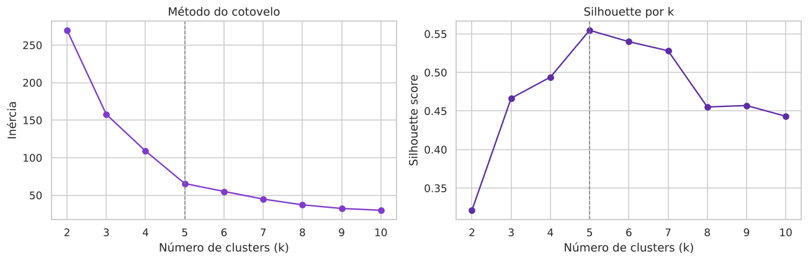
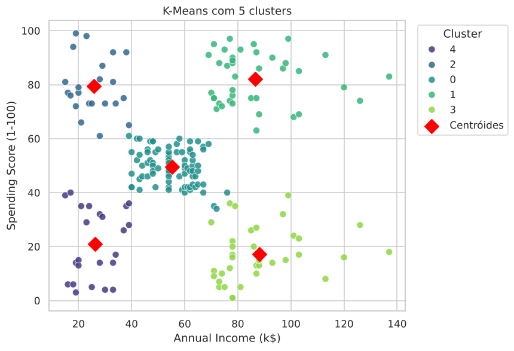
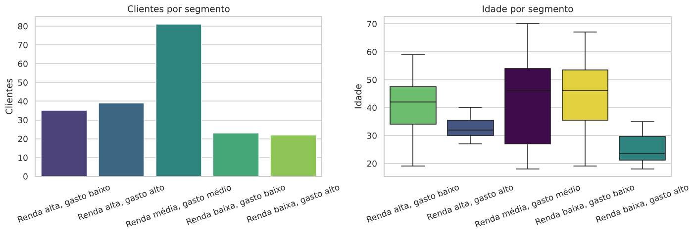

# Segmentação de Clientes com K-Means

Projeto de aprendizado não supervisionado desenvolvido no curso **Profissão: Cientista de Dados (EBAC)**, Módulo 33. O objetivo é agrupar os clientes de um shopping em segmentos com comportamento de compra semelhante, para que o marketing trate cada grupo com uma ação específica em vez de uma campanha única para toda a base.

O modelo final, **K-Means com 5 clusters**, foi escolhido com base em três evidências: método do cotovelo, silhouette score máximo (**0,555**) e separação visual clara dos grupos.

---

## 1. O problema

Um shopping atribui a cada cliente uma pontuação de gastos (1 a 100) com base no comportamento de compra e conhece a renda anual declarada. A pergunta de negócio é: **existem grupos de clientes com perfis distintos de renda e gasto, e o que fazer com cada um?**

Sem rótulos prévios, o problema é de clusterização. O K-Means foi escolhido por ser simples de interpretar (cada grupo é descrito pelo seu centróide) e adequado a grupos compactos e bem separados, como os que a análise exploratória sugere.

## 2. Os dados

`data/Mall_Customers.csv`: 200 clientes, 5 colunas, sem valores ausentes.

| Coluna | Descrição |
|:--|:--|
| `CustomerID` | Identificador do cliente |
| `Gender` | Gênero (112 mulheres, 88 homens) |
| `Age` | Idade (18 a 70 anos) |
| `Annual Income (k$)` | Renda anual em milhares de dólares (15 a 137) |
| `Spending Score (1-100)` | Pontuação de gastos atribuída pelo shopping (1 a 99) |

## 3. Pipeline

```
Carga → EDA (distribuições, pairplot) → Padronização (StandardScaler em renda e score)
→ Escolha de k (cotovelo + silhouette, k de 2 a 10) → K-Means com 3, 4 e 5 clusters
→ Centróides na escala original → Perfil dos segmentos (idade e gênero) → Recomendações
```

Notebook completo: [`notebooks/segmentacao_clientes_kmeans.ipynb`](notebooks/segmentacao_clientes_kmeans.ipynb)
Documentação técnica com a justificativa de cada decisão: [`docs/documentacao_tecnica.md`](docs/documentacao_tecnica.md)

## 4. Resultados

### Escolha do número de clusters

| k | Inércia | Silhouette |
|--:|--:|--:|
| 2 | 269,7 | 0,321 |
| 3 | 157,7 | 0,467 |
| 4 | 108,9 | 0,494 |
| **5** | **65,6** | **0,555** |
| 6 | 55,1 | 0,540 |
| 7 | 44,9 | 0,528 |
| 8 | 37,2 | 0,455 |

<p align="center">
  
</p>

### Segmentos encontrados

<p align="center">
  
</p>

| Segmento | Clientes | Renda média (k$) | Score médio | Idade média | Ação sugerida |
|:--|--:|--:|--:|--:|:--|
| Renda alta, gasto alto | 39 | 86,5 | 82,1 | 32,7 | Fidelidade, lançamentos, atendimento prioritário |
| Renda alta, gasto baixo | 35 | 88,2 | 17,1 | 41,1 | Produtos exclusivos e campanhas de reativação |
| Renda média, gasto médio | 81 | 55,3 | 49,5 | 42,7 | Promoções sazonais e cross-sell para elevar o ticket |
| Renda baixa, gasto alto | 22 | 25,7 | 79,4 | 25,3 | Parcelamento e cashback, com atenção à inadimplência |
| Renda baixa, gasto baixo | 23 | 26,3 | 20,9 | 45,2 | Ofertas de estoque antigo, baixo investimento |

<p align="center">
  
</p>

**Principais conclusões**

- **Cinco segmentos com perfis claramente distintos**: os quatro "cantos" do gráfico renda x score formam grupos próprios, e o centro concentra o maior grupo (81 clientes, 40 % da base), de comportamento regular.
- **A idade diferencia os grupos mesmo sem entrar no modelo**: quem gasta muito é jovem (média de 25 anos no grupo de renda baixa e 33 no de renda alta); quem gasta pouco tem em média mais de 40 anos.
- **O grupo de maior oportunidade é "renda alta, gasto baixo"**: 35 clientes com capacidade de compra que hoje gastam pouco no shopping.
- **A padronização foi indispensável**: renda e score têm escalas diferentes e o K-Means é baseado em distância euclidiana.

## 5. Estrutura do repositório

```
customer-segmentation-kmeans/
├── README.md
├── requirements.txt
├── data/
│   └── Mall_Customers.csv
├── notebooks/
│   └── segmentacao_clientes_kmeans.ipynb
├── docs/
│   └── documentacao_tecnica.md
└── images/                      ← EDA, cotovelo e silhouette, clusters e perfil dos segmentos
```

## 6. Como executar

```bash
git clone https://github.com/JMateus1997/customer-segmentation-kmeans.git
cd customer-segmentation-kmeans
pip install -r requirements.txt
jupyter notebook notebooks/segmentacao_clientes_kmeans.ipynb
```

## 7. Tecnologias

Python · pandas · NumPy · scikit-learn · Matplotlib · Seaborn

## 8. Autor

**João Mateus Almeida**, projeto desenvolvido no curso Profissão: Cientista de Dados, EBAC.
